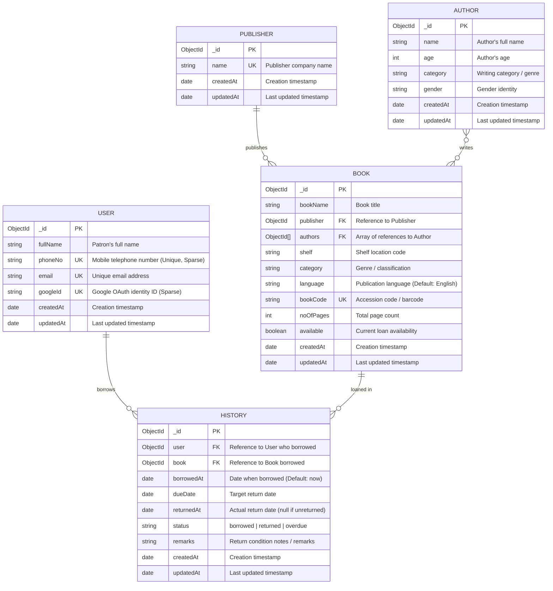

# Library Management Server

The API server is built with Node.js, Express, TypeScript, and MongoDB (via Mongoose). It follows **Clean Architecture** and **SOLID principles**, isolating domain validation rules from persistence schemas, and provides complete circulation tracking for books and patrons.

---

## Architecture & Design Principles

The backend is structured into clear layers adhering to:
- **Single Responsibility Principle (SRP)**:
  - `src/models/`: Solely responsible for ORM document typing, Mongoose persistence schemas, and database indexing.
  - `src/validators/`: Pure domain validation logic, regular expressions, constraint checks, and schema descriptor objects.
- **Open/Closed Principle (OCP)**: New validation rules or constraints can be added or adjusted in `src/validators/` without mutating schema structures.
- **Dependency Inversion Principle (DIP)**: Models consume validation contracts rather than embedding tight, inline anonymous validation closures.

```
backend/src/
├── config/
│   └── database.ts            # MongoDB connection lifecycle & event handlers
├── models/                    # Persistence schemas & index definitions
│   ├── User.ts
│   ├── Book.ts
│   ├── Author.ts
│   ├── Publisher.ts
│   ├── History.ts
│   └── index.ts
└── validators/                # Decoupled domain validation rules
    ├── user.validator.ts
    ├── book.validator.ts
    ├── author.validator.ts
    ├── publisher.validator.ts
    ├── history.validator.ts
    └── index.ts
```

---

## Database Design & Entity-Relationship (ER) Diagram

### ER Diagram



---

## Schema Specifications

### 1. `User` (`src/models/User.ts`)
| Field | Type | Attributes & Validation |
| :--- | :--- | :--- |
| `fullName` | `String` | Required, trimmed, validated by `UserValidators.fullNameValidator` |
| `phoneNo` | `String` | Unique, sparse, trimmed, validated by `UserValidators.phoneValidator` |
| `email` | `String` | Required, unique, lowercase, trimmed, validated by `UserValidators.emailValidator` |
| `googleId` | `String` | Optional, unique, sparse, trimmed for Google OAuth |
| `timestamps` | `Date` | Managed automatically (`createdAt`, `updatedAt`) |

### 2. `Book` (`src/models/Book.ts`)
| Field | Type | Attributes & Validation |
| :--- | :--- | :--- |
| `bookName` | `String` | Required, trimmed, indexed |
| `publisher` | `ObjectId` | Required, ref: `Publisher`, indexed |
| `authors` | `ObjectId[]` | Required, ref: `Author[]`, validated $\ge 1$ by `BookValidators.authorsValidator` |
| `shelf` | `String` | Required, trimmed, indexed (physical shelf location) |
| `category` | `String` | Required, trimmed, indexed (genre/category) |
| `language` | `String` | Required, default: `'English'`, trimmed, indexed, validated by `BookValidators.languageValidator` |
| `bookCode` | `String` | Required, unique, uppercase, trimmed, indexed, validated by `BookValidators.bookCodeValidator` |
| `noOfPages` | `Number` | Required, positive integer $\ge 1$, validated by `BookValidators.pageCountValidator` |
| `available` | `Boolean` | Default: `true`, indexed for catalog filtering |
| `timestamps` | `Date` | Managed automatically (`createdAt`, `updatedAt`) |

### 3. `Publisher` (`src/models/Publisher.ts`)
| Field | Type | Attributes & Validation |
| :--- | :--- | :--- |
| `name` | `String` | Required, unique, trimmed, validated by `PublisherValidators.nameValidator` |
| `timestamps` | `Date` | Managed automatically (`createdAt`, `updatedAt`) |

### 4. `Author` (`src/models/Author.ts`)
| Field | Type | Attributes & Validation |
| :--- | :--- | :--- |
| `name` | `String` | Required, trimmed, indexed, validated by `AuthorValidators.nameValidator` |
| `age` | `Number` | Optional, non-negative integer, validated by `AuthorValidators.ageValidator` |
| `category` | `String` | Required, trimmed, indexed |
| `gender` | `String` | Optional, default: `'Not specified'`, trimmed |
| `timestamps` | `Date` | Managed automatically (`createdAt`, `updatedAt`) |

### 5. `History` (`src/models/History.ts`)
Unified collection tracking complete circulation history for **both** users and books in a single database.

| Field | Type | Attributes & Validation |
| :--- | :--- | :--- |
| `user` | `ObjectId` | Required, ref: `User`, indexed |
| `book` | `ObjectId` | Required, ref: `Book`, indexed |
| `borrowedAt` | `Date` | Required, default: `Date.now`, indexed |
| `dueDate` | `Date` | Optional expected return deadline |
| `returnedAt` | `Date \| null` | Default: `null`, indexed (timestamp when book was returned) |
| `status` | `String` | Enum: `['borrowed', 'returned', 'overdue']`, default: `'borrowed'`, validated by `HistoryValidators.statusValidator` |
| `remarks` | `String` | Optional notes or return condition remarks |
| `timestamps` | `Date` | Managed automatically (`createdAt`, `updatedAt`) |

---

## High-Performance Database Indexing

The schema applies compound and specialized indexes for rapid lookups:

| Index | Type | Purpose |
| :--- | :--- | :--- |
| `{ user: 1, borrowedAt: -1 }` | Compound | Fast query of a user's full borrowing history in reverse chronological order. |
| `{ book: 1, borrowedAt: -1 }` | Compound | Complete circulation trail of who borrowed a specific book over time. |
| `{ user: 1, status: 1 }` | Compound | Instant check for active unreturned books by user. |
| `{ book: 1, status: 1 }` | Compound | Instant check for current loan status of a book. |
| `{ email: 1 }` | Unique | Enforces single account per email. |
| `{ phoneNo: 1 }` | Sparse Unique | Enforces unique mobile numbers across all patrons without null collisions. |
| `{ googleId: 1 }` | Sparse Unique | Unique Google OAuth ID lookups without collisions for password patrons. |
| `{ bookCode: 1 }` | Unique | Instant scan / barcode / accession code lookup. |
| `{ language: 1 }` | Single field | Filter catalog by publication language. |
| `{ publisher: 1 }` | Single field | Filter books by publisher. |
| `{ category: 1, available: 1 }` | Compound | Filter available books by genre/category. |

---

## Requirements

- Node.js 20 or newer
- npm
- MongoDB Atlas cluster URI

---

## Local Development

```sh
# 1. Install dependencies
npm install

# 2. Configure environment
cp .env.example .env

# 3. Start development server in watch mode
npm run dev
```

The server listens on `http://localhost:4000` by default. When `MONGODB_URI` is set, it connects to MongoDB before accepting requests.

---

## Environment Variables

| Variable | Description | Example / Default |
| :--- | :--- | :--- |
| `PORT` | HTTP port | `4000` |
| `MONGODB_URI` | MongoDB Atlas connection string | `mongodb+srv://<user>:<password>@<cluster>/library-management?retryWrites=true&w=majority` |
| `FRONTEND_ORIGIN` | Allowed browser origin for CORS | `http://localhost:5173` |
| `NODE_ENV` | Runtime environment | `development` |

---

## Available Scripts

| Command | Purpose |
| :--- | :--- |
| `npm run dev` | Run the API with TypeScript watch mode (`tsx watch src/server.ts`) |
| `npm run build` | Compile TypeScript into `dist/` |
| `npm start` | Run the compiled server |

---

## API Endpoints

### System Health
| Method | Path | Response |
| :--- | :--- | :--- |
| `GET` | `/api/health` | `{"status": "ok", "service": "library-management-api", "database": {"connected": true, "name": "library-management"}, "timestamp": "..."}` |

### Admin Portal (`/admin`)
| Method | Path | Auth Required | Description |
| :--- | :--- | :--- | :--- |
| `POST` | `/api/admin/auth/login` | No (Throttled) | Validates username & password, issues HTTP-only browser session cookie |
| `POST` | `/api/admin/auth/logout` | No | Clears admin browser session cookie |
| `GET` | `/api/admin/auth/me` | Yes (Session) | Returns current authenticated administrator profile |
| `GET` | `/api/admin/dashboard/stats` | Yes (Session) | Aggregates live metrics (books, loans, patrons, overdue count) |

### Admin Session & Security Specifications
- **Throttling Protection**: Enforces rate limits on consecutive attempts (minimum 1.5s interval between submissions, maximum 5 attempts/minute with 30s block duration).
- **Browser-Scoped Session**: Session cookie is issued without `maxAge` / `expires` header, and token is retained strictly in client `sessionStorage`. When the browser is closed, the session expires automatically.

